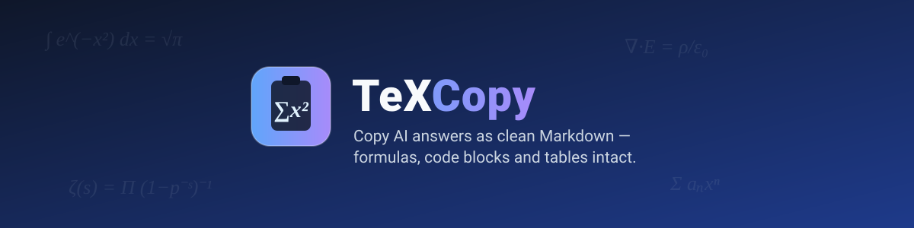
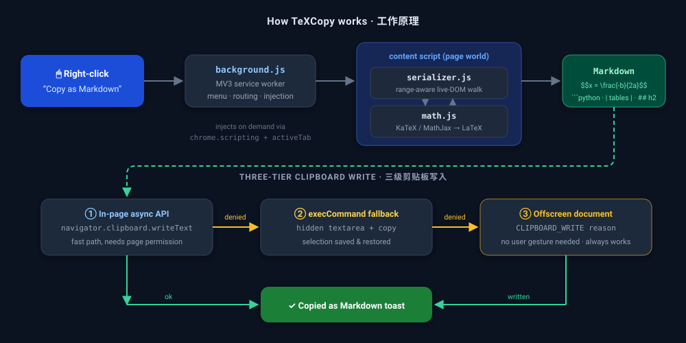

<p align="center">
  
</p>

<p align="center">
  
  
  
  
  
</p>

---

Ever tried copying an AI answer with math in it — and got `x=−b±√b2−4ac2a` garbage instead of the formula? Or lost every heading, code fence and table on the way?

在 AI 聊天页面复制带公式的回答，粘贴出来经常是 `x=−b±√b2−4ac2a` 这样的乱码，标题、代码块、表格也全丢了格式。

**TeXCopy** fixes that. Select any content on any page, right-click → **Copy as Markdown**, and get faithful, clean Markdown in your clipboard.

**TeXCopy（复制增强器）**解决这个问题：在任意网页选中内容 → 右键 → **Copy as Markdown**，剪贴板里就是干净、忠实的 Markdown。

<p align="center">
  
</p>

## ✨ Features · 功能特性

- 🧮 **Math preserved as LaTeX** — KaTeX formulas are recovered *losslessly* from their embedded source annotations; MathJax falls back to a MathML→TeX converter. Inline `$…$`, display `$$…$$`.
  **公式无损还原为 LaTeX** —— KaTeX 直接从内嵌源码注解读取（元宝 / ChatGPT / Claude / Kimi 等）；MathJax 走 MathML→TeX 子集转换（DeepSeek 等）。行内 `$…$`，块级 `$$…$$`。

- 💻 **Real code blocks** — fenced, with language tags, no line-number or UI garbage.
  **代码块**还原为带语言标记的围栏形式，无行号、无按钮文字混入。

- 📋 **Full structure** — headings, bold/italic, nested lists, GFM tables, blockquotes, links, horizontal rules.
  **完整结构**：标题、加粗/斜体、嵌套列表、GFM 表格、引用、链接、分隔线。

- 🧹 **Noise filtered out** — copy/like/regenerate buttons, toolbars, `aria-hidden` widgets never make it into your clipboard.
  **自动过滤噪音**：复制/点赞/重新生成按钮、工具条、`aria-hidden` 元素统统不进剪贴板。

- ✂️ **Partial selection works** — select half a sentence, half a table or part of a list: only what you selected is copied (formulas and code blocks stay whole, because half a formula is meaningless).
  **支持部分选中**：选中半句话、半个表格、列表的一部分，只输出选区内容（公式和代码块保持完整——半个公式没有意义）。

- 🔒 **Zero page intrusion** — TeXCopy never touches `Ctrl+C`. It only runs when *you* click the context-menu item.
  **对页面零侵入**：不拦截 `Ctrl+C`，只在你主动点击右键菜单时工作。

## 🔍 Before / After · 效果对比

| On the page 页面上 | Native copy 原生复制 | TeXCopy |
|---|---|---|
| Rendered fraction 渲染后的分式 | `x=−b±√b2−4ac2a` | `$$x = \frac{-b \pm \sqrt{b^2-4ac}}{2a}$$` |
| Python code block 代码块 | flattened one-liner with UI text 压扁成一行还混入按钮文字 | ` ```python … ``` ` with newlines intact 换行完整 |
| Comparison table 对比表格 | tab-separated mush 制表符糊成一团 | proper GFM pipe table 标准 GFM 管道表格 |
| Headings & lists 标题和列表 | plain lines 纯文本行 | `##`, `-`, `1.` markers preserved 标记全保留 |

## 📦 Install · 安装

Not on the Chrome Web Store (yet) — load it unpacked, it takes 20 seconds.
暂未上架 Chrome 应用商店——本地加载只需 20 秒。

```bash
git clone https://github.com/Misa-XU/texcopy.git
```

1. Open `chrome://extensions` · 打开 `chrome://extensions`
2. Enable **Developer mode** (top-right toggle) · 开启右上角**开发者模式**
3. Click **Load unpacked** and select the `texcopy` folder · 点击**加载已解压的扩展程序**，选择 `texcopy` 目录
4. Done — no configuration, no sign-in · 完成，无需任何配置

> Works in any Chromium browser: Chrome, Edge, Brave, Arc, Opera…
> 适用于所有 Chromium 系浏览器。

## 🚀 Usage · 使用

1. Select content on any page (an AI answer, a blog post, docs…) · 在任意网页选中内容（AI 回答、博客、文档……）
2. Right-click → **Copy as Markdown** · 右键 → **Copy as Markdown**
3. Paste anywhere. A green toast confirms success. · 到任意地方粘贴，绿色提示表示成功。

**Where it shines · 最佳场景**：ChatGPT · Claude · Tencent Yuanbao (元宝) · Kimi · DeepSeek · Gemini · Zhihu 知乎 · CSDN · Juejin 掘金 — and honestly, any HTML page · 以及任何普通网页。

## ⚙️ How it works · 工作原理

<p align="center">
  
</p>

- **Live-DOM range walking.** Instead of `Range.cloneContents()` (detached nodes have no layout or computed styles — a classic source of subtle bugs), the serializer walks the *live* DOM along the range boundaries using `comparePoint`, slicing text nodes at the exact selection offsets.
  **活 DOM 按选区遍历**：不用 `cloneContents()`（克隆节点没有布局和计算样式，是一类经典 bug 的根源），而是用 `comparePoint` 沿选区边界在活 DOM 上遍历，文本节点按选区偏移精确切片。

- **Lossless math for KaTeX.** KaTeX embeds the original TeX in `<annotation encoding="application/x-tex">`; TeXCopy reads it back verbatim. For MathJax without annotations, a subset MathML→TeX converter handles fractions, sub/superscripts, roots, big operators, Greek letters and more — with graceful fallbacks so content is never silently lost.
  **KaTeX 公式无损还原**：KaTeX 会在 `<annotation encoding="application/x-tex">` 中保留原始 TeX，直接读取即可；MathJax 无注解时走子集级 MathML→TeX 转换（分数、上下标、根号、大型运算符、希腊字母等），多级兜底确保内容永不丢失。

- **Three-tier clipboard strategy.** A context-menu click grants no user gesture to the page, so `navigator.clipboard` may be denied. TeXCopy falls back to `execCommand`, then to an MV3 **offscreen document** holding the extension's own clipboard permission — the most reliable channel.
  **三级剪贴板保障**：右键菜单点击不给页面用户手势，`navigator.clipboard` 可能被拒；TeXCopy 依次降级到 `execCommand`、再到 MV3 **offscreen document**（持扩展自身剪贴板权限，最可靠）。

- **On-demand injection.** Pages opened before the extension was installed get the content script injected via `chrome.scripting` (authorized by `activeTab` from the menu click). No refresh needed.
  **按需注入**：装扩展前已打开的页面，通过 `chrome.scripting` + `activeTab`（由菜单点击授权）即时注入，无需刷新。

## 📁 Project layout · 项目结构

```
├── manifest.json        # MV3 manifest
├── background.js        # context menu, on-demand injection, offscreen fallback
├── offscreen.html/js    # reliable clipboard channel (no user gesture needed)
├── content/
│   ├── main.js          # message entry: selection → serialize → clipboard → toast
│   ├── serializer.js    # range-aware DOM → Markdown walker (zero deps)
│   ├── math.js          # KaTeX / MathJax → LaTeX recovery
│   └── clipboard.js     # in-page clipboard write with fallbacks
├── assets/              # banner · animated demo · architecture diagram (SVG)
├── icons/               # generated by tools/gen_icons.js
└── test/
    ├── run_tests.js     # jsdom test suite (27 tests)
    └── test_page.html   # manual browser test page (KaTeX via CDN)
```

## 🛠 Development · 开发

No build step. No runtime dependencies. 无构建步骤，运行时零依赖。

```bash
# run the test suite (jsdom) · 运行测试
cd test && npm install jsdom --no-audit   # first time only · 仅首次
node test/run_tests.js                    # from repo root · 在仓库根目录运行

# regenerate icons · 重新生成图标
node tools/gen_icons.js

# manual browser test · 手动浏览器测试
# open test/test_page.html and follow the yellow banner · 打开 test/test_page.html 按页面顶部黄色提示操作
```

## 🗺 Roadmap · 路线图

- [ ] Rich-text (HTML) clipboard output alongside Markdown · 剪贴板同时写入富文本（HTML）格式
- [ ] Popup with per-site preferences · Popup 设置界面（按站点开关）
- [ ] Copy a whole AI message with one click (no selection needed) · 一键复制整条 AI 消息（免选中）
- [ ] Firefox port · Firefox 版本
- [ ] Chrome Web Store listing · 上架 Chrome 应用商店

## 📄 License · 许可证

[MIT](LICENSE) © 2026 Misa-XU
